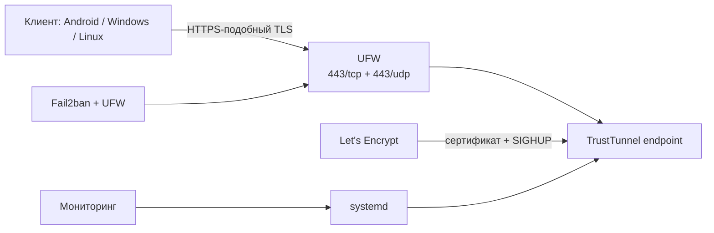

# Secure Internet Kit

**VPN-набор для компьютерного мастера: свежий Ubuntu VPS → защищённый сервер для клиентов за одну команду.**

[](#требования)
[](#что-внутри)
[](#быстрый-старт)
[](LICENSE)
[](#ограничения)

---

## Что это

Я компьютерный мастер. Ко мне приходят с «почини компьютер», а уходят ещё и с безопасным интернетом на телефоне, ноутбуке и планшете. Это небольшая дополнительная услуга: клиент получает свой приватный VPN-сервер, а не общий IP коммерческого сервиса.

Этот репозиторий — то, чем я пользуюсь сам. Скрипты, конфиги и документация, которые превращают чистый Ubuntu VPS в готовый к работе VPN-сервер.

**Это не панель управления, не биллинг и не бизнес-платформа.** Это набор для мастера, который умеет зайти по SSH и не боится терминала.

> Протокол и бинарники — [TrustTunnel](https://github.com/TrustTunnel/TrustTunnel) от AdGuard VPN. Я не автор протокола. Я собрал обвязку: hardening, деплой, TLS, systemd, клиентский onboarding и runbooks.

---

## Что вы получите

Если вы развернёте этот набор, у вас будет:

- **Сервер, который не стыдно отдать клиенту.** SSH только по ключам, нестандартный порт, UFW, Fail2ban, автообновления, sysctl hardening.
- **HTTPS-маскировка.** TrustTunnel слушает 443/TCP и 443/UDP, трафик выглядит как обычный HTTPS/HTTP3 и хуже поддаётся DPI.
- **TLS без головной боли.** Let's Encrypt, ECDSA P-256, автопродление и `SIGHUP` без разрыва активных сессий.
- **Подключение клиента за пару минут.** Android — deep link/QR. Windows — PowerShell-инсталлер или офлайн-установка с флешки. Linux — TOML + CLI.
- **Локальные сервисы работают.** Банки, госуслуги и маркетплейсы идут напрямую, остальное — через VPN.
- **Понятная эксплуатация.** `status`, `check`, `run`, логи, health-check, продление сертификатов, шаблон карточки клиента.
- **Документацию, а не «разберёшься по коду».** Security baseline, деплой, troubleshooting, onboarding, selective routing.
- **Одну команду для нового VPS.** Ansible, bootstrap или SCP — как удобнее.

Для мастера это выглядит так: купил VPS, направил домен, прогнал установку, выдал клиенту QR или установщик. Дальше — только продление и мониторинг.

---

## Кому подходит

- Компьютерным мастерам и небольшим IT-подрядчикам.
- Тем, кто хочет предложить клиентам «безопасный интернет» как дополнительную услугу.
- Небольшим офисам на 5–10 человек.
- Тем, кто хочет свой endpoint, а не общий IP коммерческого VPN.

## Кому не подходит

- Тем, кто ищет готовую панель с кнопками, оплатой и биллингом.
- Тем, кто не готов работать с Linux, SSH и DNS.
- Тем, кому нужен enterprise SLA, 24/7 поддержка и юридическая обвязка.
- Тем, кто хочет «просто нажать кнопку» — здесь всё-таки инфраструктура.

---

## Как это работает



Снаружи сервер выглядит как обычный HTTPS-сайт на 443. Внутри — VPN-эндпоинт, который туннелирует TCP, UDP и ICMP. Клиентские конфиги содержат DoH-апстримы и список исключений для локальных сервисов.

---

## Требования

- Ubuntu 22.04 или 24.04
- 1 vCPU, 1 GB RAM, 10 GB SSD
- Root или sudo-доступ по SSH
- Домен, A-запись которого указывает на IP сервера
- Открытые порты: SSH, 80 (временно для Let's Encrypt), 443/tcp, 443/udp

Для Ansible-пути: Ansible 2.14+ на локальной машине.

---

## Быстрый старт

### 1. Подготовьте VPS

Минимум:

- Ubuntu 22.04 или 24.04
- 1 vCPU, 1 GB RAM, 10 GB SSD
- Публичный IPv4
- Root или sudo-доступ по SSH

### 2. Направьте домен на сервер

Создайте A-запись:

```
vpn.example.com  →  <IP вашего VPS>
```

Для Lite/Premium с двумя IP можно добавить второй домен:

```
lite.vpn.example.com  →  <Lite IP>
```

### 3. Запустите установку

**Вариант A — Ansible (рекомендую для повторяемых установок):**

```bash
git clone https://github.com/jefo/secure-internet-kit.git
cd secure-internet-kit

cp inventory.example.ini inventory.ini
# отредактируйте inventory.ini: IP сервера и путь к SSH-ключу

ansible-playbook -i inventory.ini deploy.yml \
  --extra-vars "ssh_pubkey='$(cat ~/.ssh/id_ed25519.pub)' \
                tls_domain=vpn.example.com \
                tls_email=you@example.com"
```

**Вариант B — bootstrap на свежем VPS:**

```bash
curl -fsSL https://raw.githubusercontent.com/jefo/secure-internet-kit/main/bootstrap.sh | bash

sudo bash /tmp/secure-internet-kit-harden/scripts/harden/run.sh status
sudo bash /tmp/secure-internet-kit-harden/scripts/harden/run.sh run
```

**Вариант C — вручную по SSH:**

```bash
scp -r scripts/harden/ root@<server_ip>:/tmp/harden/
ssh root@<server_ip>
sudo bash /tmp/harden/run.sh run
```

> **Важно:** шаг 02 меняет порт SSH и отключает вход по паролю. Не закрывайте текущую сессию. Проверьте новый порт из второго терминала.

Перед запуском шага 09 задайте домен и email:

```bash
export TLS_DOMAIN=vpn.example.com
export TLS_EMAIL=you@example.com
```

### 4. Создайте клиента

```bash
sudo VPN_DOMAIN=vpn.example.com \
     VPN_LITE_DOMAIN=lite.vpn.example.com \
     VPN_IP_PREMIUM=<premium_ip> \
     VPN_IP_LITE=<lite_ip> \
     bash scripts/generate_client.sh ivanov pro
```

Скрипт:

- создаст пользователя в `credentials.toml`;
- перезагрузит endpoint через `SIGHUP` без разрыва сессий;
- выведет deep link и QR для Android;
- выведет TOML-конфиг для Windows/Linux.

---

## Что внутри

```
scripts/harden/          10-шаговый hardening + деплой
  run.sh                 orchestrator: status / check / run
  step01..step10         отдельные шаги с --check и --run
server/                  шаблоны vpn.toml, hosts.toml, QoS
client/                  Windows-инсталлер, offline install.bat, exclusions
docs/                    security baseline, деплой, troubleshooting, onboarding
deploy.yml               Ansible playbook
bootstrap.sh             установка одной командой на свежий VPS
inventory.example.ini    шаблон inventory
```

### 10 шагов

| # | Шаг | Что делает |
|---|---|---|
| 01 | Admin user | Создаёт sudo-пользователя и ставит SSH-ключ |
| 02 | SSH | Меняет порт, отключает root-пароль и парольную аутентификацию |
| 03 | Firewall | UFW: deny incoming, только SSH + 443/tcp + 443/udp |
| 04 | Fail2ban | Банит SSH-брутфорс через UFW |
| 05 | Updates | Включает security-обновления |
| 06 | Kernel | rp_filter, ICMP redirects, SYN cookies, IPv6 off |
| 07 | Install | Ставит TrustTunnel endpoint |
| 08 | Configure | Генерирует vpn.toml, hosts.toml, credentials.toml, rules.toml |
| 09 | TLS | Let's Encrypt + автопродление |
| 10 | Service | systemd, права файлов, logrotate |

```bash
sudo bash scripts/harden/run.sh status   # что уже сделано
sudo bash scripts/harden/run.sh check    # полный аудит
sudo bash scripts/harden/run.sh run      # применить всё
sudo bash scripts/harden/run.sh run 03   # только шаг 03
```

---

## Клиенты

### Android

1. Установите TrustTunnel из Play Store.
2. Отсканируйте QR или откройте `tt://`-ссылку.
3. Нажмите «Подключиться».

### Windows

Онлайн:

```powershell
# от имени администратора
.\client\install_script_win.ps1 -DeepLink "tt://..."
```

Офлайн (флешка):

1. Положите рядом `install.bat`, `config.toml`, `trusttunnel_client.exe`, `wintun.dll`.
2. ПКМ по `install.bat` → «Запуск от имени администратора».

Клиент ставится как служба Windows и запускается автоматически.

### Linux

```bash
sudo bash scripts/generate_client.sh <user> pro
# скопируйте TOML и запустите
sudo trusttunnel_client -c trusttunnel_client.toml
```

---

## Обслуживание

| Задача | Команда |
|---|---|
| Статус сервиса | `systemctl status trusttunnel` |
| Логи | `journalctl -u trusttunnel -f` |
| Перечитать конфиг без разрыва | `kill -HUP $(pidof trusttunnel_endpoint)` |
| Продлить сертификат | `bash scripts/renew_certs.sh` |
| Health-check | `bash scripts/monitor_health.sh` |
| Новый клиент | `bash scripts/generate_client.sh <user> pro` |
| Отключить клиента | закомментировать `[[client]]` + `SIGHUP` |
| Вернуть клиента | раскомментировать + `SIGHUP` |

---

## Безопасность

**Что закрывает:**

- SSH-брутфорс и вход по паролю;
- лишние открытые порты;
- устаревшие пакеты;
- простые сетевые атаки на уровне ядра;
- доступ к файлам с паролями;
- DNS-утечки через DoH на клиенте.

**Чего не закрывает:**

- взлом клиентского устройства;
- недобросовестного VPS-провайдера;
- целенаправленные атаки;
- юридические риски в вашей юрисдикции.

Перед продакшеном прочитайте [`docs/SECURITY_STANDARDS.md`](docs/SECURITY_STANDARDS.md). Там R1–R8 и ручной чек-лист.

---

## Ограничения

- Это **домашний набор**, а не enterprise-продукт. Проверяйте на своём стенде.
- Нет панели управления, биллинга и мультитенантности.
- Dual-IP тарификация (Lite/Premium) — **экспериментальная**. Второй IP и policy routing нужно проверять на конкретном провайдере.
- Нет автоматического backup/restore. Сделайте свой.
- Нет SLA и поддержки. Это «как есть».
- `curl | sh` в bootstrap — удобно, но для продакшена лучше pinning версии и checksum.

---

## FAQ

**Почему TrustTunnel, а не WireGuard?**  
TrustTunnel маскируется под HTTPS/HTTP3 и лучше проходит DPI. WireGuard проще, но заметнее. Для «безопасного интернета» в условиях блокировок это компромисс в пользу маскировки.

**Почему 443/tcp и 443/udp?**  
TCP — совместимость и маскировка под HTTPS. UDP — QUIC/HTTP3, меньше задержки. Firewall открывает только их и SSH.

**Нужен ли домен?**  
Да, для Let's Encrypt и мобильного клиента. Self-signed подходит только для тестов и CLI.

**Можно ли ставить клиентам?**  
Да, это и есть сценарий. Но проверьте местные законы, правила провайдера и условия использования. Это ваша ответственность.

**Это production-ready?**  
Нет. Это набор, который я использую сам и делюсь. Перед коммерческой эксплуатацией добавьте мониторинг, backup, pinning версий и тесты.

---

## Благодарности

- [TrustTunnel](https://github.com/TrustTunnel/TrustTunnel) — VPN-протокол, endpoint, клиент и upstream-документация. Автор — AdGuard VPN.
- [Wintun](https://www.wintun.net/) — TUN-драйвер для Windows.
- Сообществу за открытые инструменты, без которых этого бы не было.

---

## Лицензия

Скрипты и документация этого репозитория — MIT. См. [`LICENSE`](LICENSE).
Upstream-компоненты TrustTunnel распространяются под их собственными лицензиями; см. репозиторий TrustTunnel.
